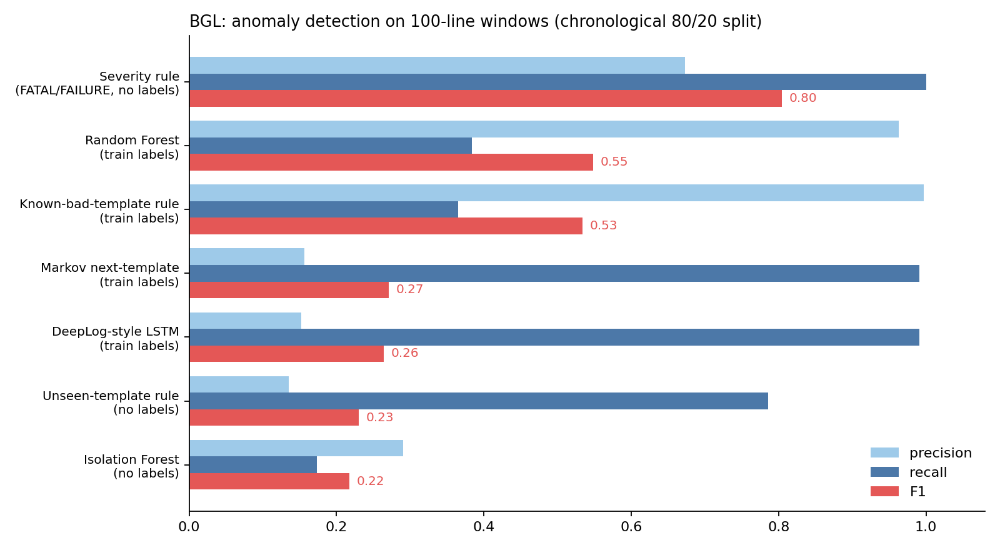
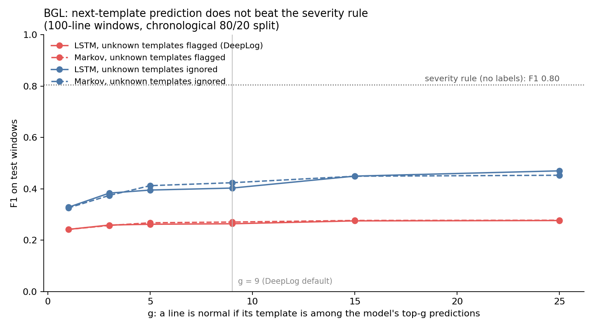
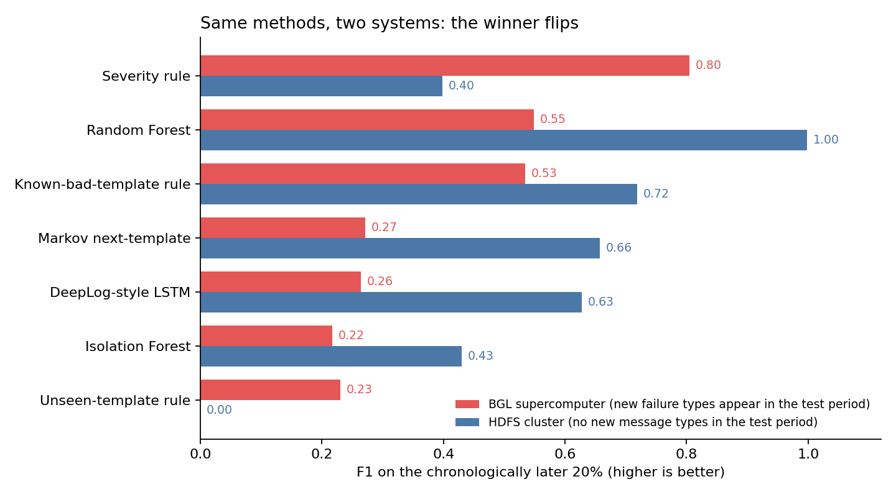

# Log Anomaly Bench

[](https://github.com/fakhri-hamza/log-anomaly-bench/actions/workflows/ci.yml)  [](LICENSE)

**How well do anomaly detectors really work on system logs, and do they beat a one-line rule?**
A reproducible benchmark of rules, classic ML, sequence models and (soon) LLM-based detectors on two public system logs: the BlueGene/L supercomputer (BGL) and a Hadoop file system cluster (HDFS).

## Headline results (BGL, 4.7M lines, chronological split)



| Method | Labels used | Precision | Recall | F1 |
|---|---|---|---|---|
| Severity rule (`FATAL`/`FAILURE` in window) | none | 0.673 | **1.000** | **0.804** |
| Random Forest (template counts) | train | 0.963 | 0.383 | 0.548 |
| Known-bad-template rule | train | 0.997 | 0.365 | 0.534 |
| Unseen-template rule | none | 0.135 | 0.785 | 0.230 |
| Markov next-template (top-9) | train (normal lines) | 0.157 | 0.991 | 0.271 |
| DeepLog-style LSTM (top-9) | train (normal lines) | 0.152 | 0.991 | 0.264 |
| Isolation Forest (template counts) | none | 0.290 | 0.174 | 0.217 |

*100-line windows · 47,480 windows · first 80% for training, last 20% for testing (no shuffling, so the models never see the future).*

### What the numbers say
1. **A one-line rule beats every model.** Flagging windows that contain a `FATAL` or `FAILURE` line catches every anomaly (recall 1.0). 99.9% of labelled anomalies are `FATAL` lines. Its weakness is precision: 4.6% of *normal* lines are also `FATAL`.
2. **Supervised models hit a wall at ~37% recall, because of concept drift.** 67% of anomalous lines in the test period come from templates **never seen during training** (e.g. a new `ciod: Error reading message prefix on CioStream socket` failure). A model trained on the past cannot recognise a failure mode that did not exist yet.
3. **Isolation Forest on template counts does poorly (F1 0.22).** "Unusual" windows are not the same as "faulty" windows: rare but harmless templates look just as unusual.
4. **Sequence models (v0.2) do not change the picture (F1 0.26–0.27).** See below.

**Takeaway:** on BGL, severity metadata carries most of the signal. A useful detector must beat that rule on *precision* while also handling *new* failure types. The sequence stage did not get there on BGL; the LLM-based stage is next.

## Sequence models: next-template prediction (v0.2)



Following DeepLog (Du et al., CCS 2017), a model learns which template usually comes next. A test line is suspicious if its real template is not among the model's top-*g* predictions (*g* = 9 as in the paper, fixed in advance), and a window is flagged if it holds a suspicious line. Templates never seen in training are always suspicious.
- **DeepLog-style LSTM:** 2 layers, 64 units, last 10 templates as input, trained 3 epochs on 500k sampled normal training lines (CPU, ~110 s for training plus scoring 950k test lines).
- **Markov baseline:** order-1 transition counts ("what usually follows template A?"), trained on all normal training lines in 3 s.

What the numbers say:
1. **The LSTM learns nothing the Markov table does not already know.** At every *g* the two F1 scores are within 0.025 of each other (`results/BGL_w100_sequence_topg.csv`).
2. **Concept drift dominates again.** **44.8%** of test lines use a template never seen in training. Flagging those (the DeepLog rule) catches 99% of anomalous windows but flags 5,248 of 9,496 test windows, so precision is 0.15.
3. **Ignoring unknown templates isolates the sequence signal**: F1 rises to 0.40–0.47 for large *g*, but recall drops to 0.61, and it is still well below the one-line severity rule (0.80).

Limitations: the *g* sweep is computed on the test period as an analysis, not used to choose *g*; window labels are coarse (100 lines), which favours any method with high recall. Two earlier limitations are tested below.

### Per-node sequences and seed stability (v0.3)
BGL interleaves **69,251 nodes** in one file, so "the previous line" is usually another machine's. Would each node's own sequence be more predictable? `python -m loganomaly.pernode` reruns both models with each line's history taken from **its own node** (`node_history_matrix`), and the LSTM with 3 seeds (42, 1, 2). Same split, windows and g = 9:

| Model | History | F1, unknown templates flagged (DeepLog rule) | F1, unknown ignored (sequence signal only) |
|---|---|---|---|
| Markov | global stream | 0.271 | 0.424 |
| Markov | per node | 0.266 | 0.423 |
| LSTM (3 seeds) | global stream | 0.270 ± 0.005 | 0.433 ± 0.028 |
| LSTM (3 seeds) | per node | 0.262 ± 0.001 | 0.403 ± 0.001 |

- **Per-node history does not help** (slightly worse for the LSTM). On BGL most anomalies are new templates or `FATAL` bursts, not unusual orderings, so cleaner sequences have little to add.
- **Seeds:** under the DeepLog rule the LSTM is stable (±0.005). With unknown templates ignored it varies by ±0.028 between seeds, so single-run differences of a few points in that setting are noise. The v0.2 single-seed number (0.40) was at the low end of that range.

## Second dataset: HDFS, where the winner flips (v0.3)



Does "a one-line rule beats ML" hold beyond one supercomputer? I ran every method unchanged on **HDFS** (11.2M lines, 575,061 block sessions, 2.9% anomalous, labelled per block by Hadoop experts). Windows are block sessions instead of 100-line blocks; the first 80% of sessions (by first appearance) are for training, the rest for testing.

| Method | Labels used | Precision | Recall | F1 on HDFS | F1 on BGL |
|---|---|---|---|---|---|
| Random Forest (template counts) | train | 1.000 | 0.996 | **0.998** | 0.548 |
| Known-bad-template rule | train | 0.714 | 0.724 | 0.719 | 0.534 |
| Markov next-template (top-9, per block) | train (normal) | 0.757 | 0.581 | 0.657 | 0.271 |
| DeepLog-style LSTM (top-9, per block) | train (normal) | 0.699 | 0.568 | 0.627 | 0.264 |
| Isolation Forest | none | 0.308 | 0.709 | 0.429 | 0.217 |
| Severity rule (`WARN` in session) | none | 1.000 | 0.248 | 0.398 | **0.804** |
| Unseen-template rule | none | 0.000 | 0.000 | 0.000 | 0.230 |

What the numbers say:
1. **On HDFS, supervised ML is nearly perfect and the severity rule is weak.** The opposite of BGL. HDFS only logs `INFO` and `WARN`; every `WARN` session is anomalous (precision 1.0), but 3 out of 4 anomalies never log a warning, so they are only visible in *which* messages appear.
2. **The difference is concept drift.** On HDFS, **no test line uses a template unseen in training** (the unseen-template rule never fires). On BGL, 67% of anomalous test lines do. When failures repeat, a model that learned them from the past wins easily; when new failure types appear, it is blind to them and a crude rule wins.
3. **So the useful question is not "rules or ML?" but "will the failures I care about look like past ones?"** That can be measured before picking a method: the share of new templates in recent data is a cheap drift signal.
4. Sequence models are much better on HDFS (0.63–0.66 vs 0.26–0.27), but still far below Random Forest. Many HDFS anomalies are blocks where expected events are *missing* or extra events appear; a "what comes next" check only sees part of that. Published DeepLog numbers on HDFS (F1 ≈ 0.96) use a different protocol (a small subset of normal sessions for training, random rather than chronological splits). I did not tune my setup to reproduce them, so these results are not comparable.

## Data
[Loghub](https://github.com/logpai/loghub) (Zhu et al., ISSRE 2023). **BGL**: 4,747,963 lines from the BlueGene/L supercomputer at LLNL, 7.3% labelled anomalous by experts. **HDFS_v1** (Xu et al., SOSP 2009): 11,175,629 lines from a 200-node Hadoop cluster, 575,061 blocks, 16,838 labelled anomalous; Drain finds 47 templates (~70k lines/s).

Drain parses the 4.7M lines into **1,128 templates** in ~35 s (≈136k lines/s on a laptop). One template, `data TLB error interrupt`, accounts for 44% of all anomalies.


## Pipeline
| Stage | Status |
|---|---|
| 1. Download data (`download.py`) | ✅ |
| 2. Parse raw logs into templates with Drain (`parse.py`) | ✅ |
| 3. Windows and bag-of-templates features (`features.py`) | ✅ |
| 4. Rules, Isolation Forest, Random Forest (`benchmark.py`) | ✅ |
| 5. Sequence models: Markov and DeepLog-style LSTM (`sequence.py`) | ✅ |
| 6. LLM-based detector + cost per million lines | ⏳ |
| 7. HDFS dataset as a second benchmark (session windows, `parse_hdfs`, `make_session_windows`) | ✅ |
| 8. Docker: one-command reproduction | ⏳ |

## Reproduce
```bash
python -m venv .venv
.venv\Scripts\activate          # Windows  (Linux/macOS: source .venv/bin/activate)
pip install -r requirements.txt && pip install -e .   # CPU-only torch: add --extra-index-url https://download.pytorch.org/whl/cpu
python -m loganomaly.download --dataset BGL       # 57 MB download, 4.7M lines
python -m loganomaly.parse --dataset BGL          # ~35 s
python -m loganomaly.benchmark --dataset BGL --window 100
python -m loganomaly.plots benchmark --dataset BGL --window 100
python -m loganomaly.sequence --dataset BGL --window 100   # top-g sweep, ~4 min on CPU
python -m loganomaly.plots sequence --dataset BGL --window 100
python -m loganomaly.pernode --dataset BGL --seeds 42 1 2   # per-node history + seeds, ~12 min on CPU
python -m loganomaly.download --dataset HDFS      # 187 MB download, 11.2M lines + block labels
python -m loganomaly.parse --dataset HDFS         # ~3 min
python -m loganomaly.benchmark --dataset HDFS     # block sessions, ~2.5 min with the LSTM
python -m loganomaly.plots datasets               # BGL vs HDFS chart
pytest
```
Use `--dataset BGL_2k` for a 2,000-line sample that runs in about a second.

## Layout
```
src/loganomaly/   download, parse (BGL + HDFS), features, benchmark, sequence, pernode, plots
tests/            unit tests (windowing, session windows, labels, Drain masking, sequence models, per-node history)
results/          metrics (CSV) and charts
data/             downloaded and parsed logs (not committed)
```

## Author
Hamza Fakhri, Computer Science engineering student, Polytech Nantes.

## License
MIT, see [LICENSE](LICENSE). The public datasets used here keep their own licenses (sources linked above).
